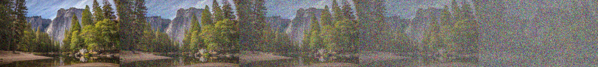
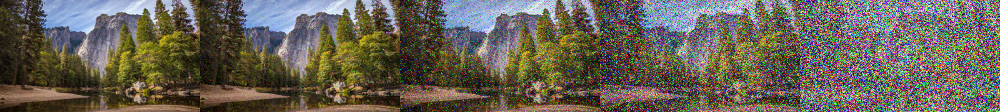
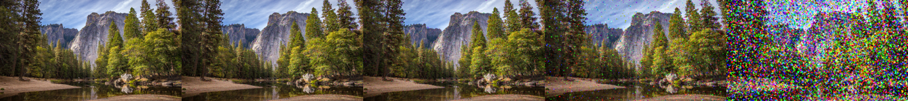
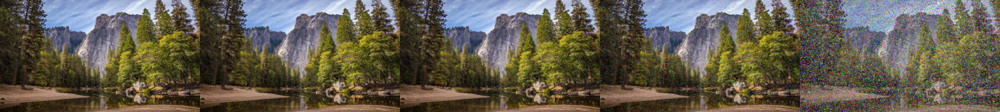
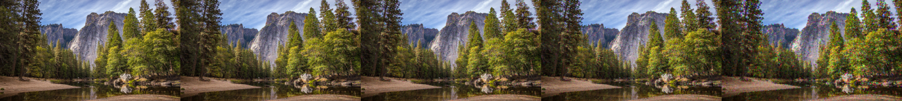
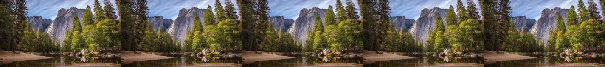
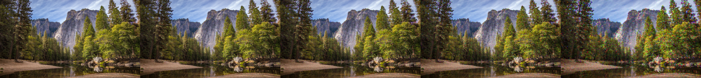

# Tuz-Biber Gürültü Giderme — Klasik ve Derin Öğrenme Yöntemlerinin Karşılaştırması

Bu depo, renkli görüntülerde **tuz-biber (salt & pepper, S&P) gürültüsünü** gideren 6 klasik / karar-tabanlı
yöntemi ve 3 derin öğrenme (DL) modelini iki görüntü setinde, beş gürültü yoğunluğunda karşılaştırır.
Karşılaştırma hem piksel düzeyinde (PSNR, SSIM, MAE, RMSE, piksel-F1) hem de bir aşağı akış görevi olan
sınıflandırma üzerinden (ResNet-18 karar uyumu) yapılır; tüm farklar görsel bazında eşleştirilmiş
istatistik testleriyle sınanır.

## İçindekiler

1. [Deney tasarımı](#1-deney-tasarımı)
2. [Yöntemler](#2-yöntemler)
3. [DL eğitim protokolü](#3-dl-eğitim-protokolü)
4. [Değerlendirme ve istatistik](#4-değerlendirme-ve-istatistik)
5. [Sonuçlar](#5-sonuçlar)
6. [Yeniden üretme (adım adım)](#6-yeniden-üretme-adım-adım)
7. [Klasör yapısı](#7-klasör-yapısı)
8. [Sürüm geçmişi ve düzeltilen hatalar](#8-sürüm-geçmişi-ve-düzeltilen-hatalar)
9. [Bilinen sınırlamalar](#9-bilinen-sınırlamalar)
10. [Örnek görseller](#10-örnek-görseller)

---

## 1. Deney tasarımı

| | Tiny ImageNet | 480p |
|---|---|---|
| Kaynak | Tiny ImageNet-200 **test** bölümü | DIV2K train + valid (yüksek çözünürlük) |
| Görsel sayısı | 1000 | 900 |
| Çözünürlük | 64×64 | 854×480 (`resize_to_480p.py`, Lanczos) |
| Sınıf etiketi | yok (test etiketleri yayınlanmıyor) | yok |

**Gürültü modeli.** Gürültülü görseller MATLAB `imnoise(I, 'salt & pepper', d)` ile üretilir,
d ∈ {0.1, 0.3, 0.5, 0.7, 0.9}. `imnoise` RGB görselde **her kanalı bağımsız** bozar: her kanal değeri
d/2 olasılıkla 0 (biber), d/2 olasılıkla 255 (tuz) olur. Bu yüzden bir pikselin yalnızca bir kanalı bozuk
olabilir (ör. %50 seviyede piksellerin %86'sında en az bir kanal bozuk, yalnızca %4'ünde üç kanal birden).

**Ortak gürültü tespit kuralı.** Karar-tabanlı tüm yöntemler (MDBUTMF, DAMF, EMPR, HDMR) ve maskeli DL
modelleri (DnCNN-SP, SeConvUNet) bozuk değeri aynı kuralla tespit eder: **kanal değeri 0 veya 255 ise şüpheli**.
Böylece klasik ve DL yöntemleri aynı bilgiyle yarışır.

## 2. Yöntemler

| Yöntem | Tür | Kısa açıklama | Dosya |
|---|---|---|---|
| SMF | Klasik | 3×3 standart medyan filtresi (kanal başına, simetrik kenar dolgusu) | `run_SMF_levels.m` |
| AMF | Klasik | Uyarlamalı medyan filtresi, en büyük pencere 7×7 | `run_AMF_levels.m` |
| MDBUTMF | Karar-tabanlı | Modified Decision Based Unsymmetric Trimmed Median Filter: 3×3 pencerede 0/255 olmayan değerlerin medyanı | `run_MDBUTMF_levels.m` |
| DAMF | Karar-tabanlı | Bozuk değeri, büyüyen pencerede (3×3 → 9×9) bozuk olmayan komşuların medyanıyla değiştirir | `run_DAMF_levels.m` |
| EMPR | Karar-tabanlı | Enhanced Multivariance Products Representation tabanlı yeniden yapılandırma (3×3 → 7×7 pencere) | `run_EMPR_levels.m` + `EMPR0.m`, `EMPR1.m`, `mysupports.m`, `standartiki.m` |
| HDMR | Karar-tabanlı | High Dimensional Model Representation tabanlı yeniden yapılandırma (3×3 → 7×7 pencere) | `run_HDMR_levels.m` + `hdmr.m`, `standartiki.m` |
| DnCNN | DL | 17 katmanlı DnCNN, rezidüel öğrenme (çıktı = x − f(x)), maskesiz 3 kanal girdi | `ai_based_models/src/models/dncnn.py` |
| DnCNN-SP | DL | DnCNN gövdesi; girdi RGB + kanal bazlı maske (6 kanal), doğrudan tahmin; çıktı = maske·tahmin + (1−maske)·girdi, yani yalnızca şüpheli kanallar değişir | `ai_based_models/src/models/dncnn_sp.py` |
| SeConvUNet | DL | 3 seviyeli U-Net (taban 48 kanal); tüm evrişimler maskeyi katmandan katmana aktaran *partial convolution*; çıktı DnCNN-SP gibi maskeyle sınırlanır | `ai_based_models/src/models/seconv_unet.py` |

Klasik yöntemler MATLAB'da kanal başına uygulanır. EMPR ve HDMR uygulamaları danışmandan alınmıştır.

## 3. DL eğitim protokolü

Üç model **aynı tarifle** eğitilir (makaledeki sürüm: **v5**, `ai_based_models/configs/*_v5.yaml`):

| Ayar | Değer |
|---|---|
| Eğitim verisi | Tiny ImageNet **train** (100.000 görsel, 64×64; test setinden tamamen ayrı) |
| Yama | 64×64 (büyütme yok) |
| Gürültü | Her örnek için d ~ U(0.1, 0.9); `imnoise` ile birebir aynı kanal bazlı model (`add_sp_noise`) |
| Maske | Kanal değeri 0 veya 255 → 1 (`sp_mask_channel`), test ile aynı kural |
| Kayıp | L1; maskeli modellerde şüpheli kanallar 6× ağırlıklı |
| Optimizasyon | AdamW; lr 2e-4 (DnCNN, DnCNN-SP), 1e-4 (SeConvUNet); kosinüs azaltımı (lr'nin %1'ine kadar) |
| Süre | 50 epoch, batch 64, seed 0 |
| Model seçimi | Tiny ImageNet **val** setinin ilk 500 görseli × 5 seviye (sabit seed'li gürültü); ortalama val PSNR'ı en yüksek epoch |

En iyi epoch'lar ve doğrulama PSNR'ı (5 seviye ortalaması):

| Model | En iyi epoch | Val PSNR (dB) | Yakınsama kontrolü: aynı tarif 30 epoch (v4) |
|---|---|---|---|
| DnCNN | 48 | 30.27 | 28.80 |
| DnCNN-SP | 49 | 31.56 | 30.98 |
| SeConvUNet | 50 | 30.37 | 29.41 |

Makalede v5'in kullanılacağı, test sonuçlarına bakılmadan önce kararlaştırılmıştır (test seti hiçbir seçimde
kullanılmadı). Epoch bazında eğitim kayıtları: `results/training/`.

## 4. Değerlendirme ve istatistik

Tüm yöntemler **tek betikle, aynı fonksiyonlarla** ölçülür (`evaluate.py`). Metrikler görsel başına
hesaplanıp ortalanır:

| Metrik | Tanım |
|---|---|
| PSNR (dB) | RGB, `10·log10(255²/MSE)`; MSE = 0 ise 100 dB'e sabitlenir |
| SSIM | RGB, `skimage` `structural_similarity`, `data_range=255` |
| MAE, RMSE | RGB, 0–255 ölçeğinde |
| Piksel Precision / Recall / F1 | *Bozuk piksel*: gürültülü görselde en az bir kanalı orijinalden farklı. *Düzeltilmiş*: çıktının tüm kanalları orijinale ±10 içinde. TP = bozuk ∧ düzeltilmiş, FN = bozuk ∧ ¬düzeltilmiş, FP = temiz ∧ ¬düzeltilmiş (yöntem zarar vermiş) |
| Top-1 karar uyumu (%) | ImageNet ağırlıklı ResNet-18'in temizlenmiş görseldeki tahmininin, temiz orijinaldeki tahminiyle aynı olma oranı. Yalnız Tiny (gerçek-etiket doğruluğu **değildir**) |

**İstatistik** (`stats.py`). Her (veri seti, seviye, metrik) için tüm yöntem çiftleri görsel bazında
eşleştirilmiş testle karşılaştırılır: sürekli metriklerde Wilcoxon işaretli sıra testi, Top-1 uyumunda kesin
McNemar testi. 1980 testin hepsine birlikte Holm düzeltmesi uygulanır (α = 0.05). Çıktı:
`results/stats_pairwise.csv` (ortalama fark, her yöntemin kazandığı görsel oranı, p, Holm-p).

## 5. Sonuçlar

Tüm sayılar `results/` altındaki dosyalardan alınmıştır (v5 DL modelleri, düzeltilmiş MDBUTMF/SMF).

### 5.1 Ortalama sonuçlar (5 gürültü seviyesinin ortalaması)

| Yöntem | Tiny PSNR | Tiny SSIM | Tiny F1 | Tiny Top-1 % | 480p PSNR | 480p SSIM | 480p F1 |
|---|---|---|---|---|---|---|---|
| Gürültülü girdi | 8.89 | 0.171 | 0.036 | 0.5 | 8.82 | 0.104 | 0.036 |
| SMF | 13.58 | 0.351 | 0.280 | 3.2 | 14.93 | 0.359 | 0.423 |
| AMF | 18.67 | 0.626 | 0.457 | 10.2 | 21.41 | 0.669 | 0.643 |
| MDBUTMF | 20.82 | 0.672 | 0.499 | 15.1 | 23.66 | 0.682 | 0.671 |
| EMPR | 22.29 | 0.760 | 0.551 | 15.8 | 25.79 | 0.831 | 0.753 |
| HDMR | 22.46 | 0.763 | 0.557 | 17.1 | 25.96 | 0.832 | 0.759 |
| DAMF | 22.25 | 0.758 | 0.563 | 16.4 | 26.13 | 0.829 | 0.768 |
| DnCNN | 29.61 | 0.886 | 0.840 | 57.3 | 30.11 | 0.892 | 0.864 |
| **DnCNN-SP** | **31.03** | **0.902** | **0.853** | **59.4** | **32.15** | **0.911** | **0.879** |
| SeConvUNet | 29.78 | 0.889 | 0.809 | 53.2 | 30.97 | 0.901 | 0.860 |

### 5.2 Seviye bazında PSNR (dB)

| Yöntem | Tiny %10 | %30 | %50 | %70 | %90 | 480p %10 | %30 | %50 | %70 | %90 |
|---|---|---|---|---|---|---|---|---|---|---|
| MDBUTMF | 28.27 | 24.15 | 21.24 | 17.73 | 12.69 | 33.01 | 27.91 | 24.52 | 19.76 | 13.09 |
| EMPR | 27.94 | 24.41 | 22.09 | 19.88 | 17.14 | 32.14 | 27.97 | 25.47 | 23.13 | 20.23 |
| HDMR | 28.38 | 24.66 | 22.20 | 19.92 | 17.16 | 32.60 | 28.23 | 25.57 | 23.15 | 20.23 |
| DAMF | 28.30 | 24.39 | 21.90 | 19.76 | 16.90 | 33.30 | 28.42 | 25.61 | 23.27 | 20.06 |
| DnCNN | 39.10 | 34.93 | 29.34 | 24.86 | 19.82 | 32.96 | 35.32 | 31.40 | 27.82 | 23.03 |
| DnCNN-SP | 44.07 | 35.41 | 29.87 | 25.36 | 20.44 | 41.38 | 35.82 | 31.79 | 28.16 | 23.61 |
| SeConvUNet | 42.00 | 33.69 | 28.60 | 24.51 | 20.11 | 39.69 | 34.15 | 30.44 | 27.22 | 23.34 |

Seviye bazında Top-1 uyumu (Tiny, %): DnCNN-SP 93.0 / 81.5 / 66.7 / 46.4 / 9.4;
HDMR 46.2 / 24.9 / 10.3 / 3.7 / 0.6; DAMF 46.4 / 22.5 / 9.3 / 3.4 / 0.2 (%10 → %90).
Tüm tablolar: `results/summary.csv`; grafik: `results/psnr_ssim.png`.

### 5.3 Bulgular

1. **DL modelleri tüm seviyelerde önde.** HDMR, EMPR ve DAMF'ye göre ortalama PSNR farkı Tiny'de 7.1–8.8 dB,
   480p'de 4.0–6.4 dB. DL modelleri yalnızca Tiny ImageNet ile eğitildiği hâlde hiç görmedikleri 480p (DIV2K)
   setinde de önde.
2. **Sınıflandırmada fark daha büyük.** DL ile temizlenen görsellerde ResNet-18 temiz görseldeki kararını
   3.1–3.8 kat daha sık koruyor.
3. **Klasik/karar-tabanlı yöntemlerin anlamlı üstünlüğü yalnızca 4 hücrede**: 480p %10'da *maskesiz* DnCNN'e karşı
   SSIM (MDBUTMF, EMPR, HDMR, DAMF; Holm-p < 10⁻¹²). Nedeni, bu yöntemlerin sağlam pikselleri hiç değiştirmemesi;
   maskesiz DnCNN her pikseli değiştiriyor. Maskeli modeller (DnCNN-SP, SeConvUNet) hiçbir hücrede geçilmiyor.
4. **Görsel bazında**, en iyi klasik yöntem DnCNN-SP'yi PSNR'da görsellerin yalnızca %0.2–1.1'inde geçiyor; bunlar
   çok düz, az dokulu görsellerdir (480p'de ortalama gradyan ~12'ye karşı diğer görsellerde ~25).
5. **Klasik yöntemler kendi aralarında**: HDMR, Tiny'de PSNR ve SSIM'de çoğu seviyede ikinciden anlamlı biçimde
   iyi; DAMF 480p'de %10–70 PSNR'da ve iki sette MAE/F1'de önde. EMPR, HDMR ve DAMF birbirine çok yakın
   (ortalama PSNR farkı < 0.4 dB).

## 6. Yeniden üretme (adım adım)

### Ortam

- **MATLAB** (Image Processing Toolbox; AMF/DAMF/EMPR/HDMR için Parallel Computing Toolbox — `parfor`)
- **Python 3.12**, `pip install -r ai_based_models/requirements.txt`
  (kullanılan sürümler: torch 2.10.0+cu128, torchvision 0.25.0, numpy 2.3.5, scipy 1.17.1, scikit-image 0.26.0,
  pandas 3.0.2, opencv 4.13.0, pillow 12.0.0, matplotlib 3.10.9)
- Veri (git'te yok): `tiny-imagenet-200/` (train/val/test), `480p-Test/Originals/DIV2K_{train,valid}_HR/`,
  `Tiny-Imagenet/Tiny_Orijinal/` (Tiny ImageNet test görselleri, `test_N.JPEG`)

### Adımlar

```
Veri hazırlama
1. generate_all_noise_levels.m          → Tiny-Imagenet/Tiny_Noisy_{10,30,50,70,90}/
2. python resize_to_480p.py             → 480p-Test/Originals_resized/   (900 görsel)
3. generate_480p_noise.m                → 480p-Test/Noisy_{10,30,50,70,90}/

Klasik yöntemler (MATLAB) — her run_*_levels.m dosyasında 7–10. satırlardaki Tiny / 480p klasör
satırlarından biri aktif edilir; iki veri seti için ayrı ayrı çalıştırılır
4. run_SMF_levels.m · run_AMF_levels.m · run_MDBUTMF_levels.m
   run_EMPR_levels.m · run_HDMR_levels.m · run_DAMF_levels.m
   → Tiny-Imagenet/Tiny_Cleaned_{YÖNTEM}_{10..90}/  ve  480p-Test/Cleaned_{YÖNTEM}_{10..90}/

DL yöntemleri (Python)
5. bash ai_based_models/train_all.sh    → ai_based_models/weights/*_v5.pth   (~3.5 saat, RTX 5080)
6. bash ai_based_models/infer_all.sh    → *_Cleaned_{DnCNN,DnCNN_SP,SeConvUNet}_{10..90}/ (iki set)

Değerlendirme
7. python evaluate.py                   → results/summary.csv, average_{tiny,480p}.csv,
                                          delta_480p_minus_tiny.csv, psnr_ssim.{png,pdf}, per_image.csv
8. python stats.py                      → results/stats_pairwise.csv
```

Notlar:
- Gürültü betikleri artık `rng(42)` ile sabit seed kullanır. Mevcut gürültülü veri seed'siz üretildiği için
  betikleri yeniden çalıştırmak **farklı** gürültü üretir; bu durumda 4–8. adımların tamamı tekrarlanmalıdır.
- `infer.py` yalnızca `noise_model = channelwise_v3` etiketli (yani bu protokolle eğitilmiş) ağırlıkları kabul eder.
- **WSL + GPU uyarısı:** Bu çalışmada WSL2 içinde 480p görsellerde GPU ile çıkarım sırasında WSL sanal makinesi
  `dxg` (GPU paravirtualization) bellek ayırma hatalarıyla birkaç kez çöktü. Bu nedenle SeConvUNet'in 480p
  çıktıları CPU'da üretildi (`CUDA_VISIBLE_DEVICES=""`); CPU ve GPU çıktıları değerlerin %0.2–0.4'ünde yalnızca
  ±1 gri seviye farklıdır. Uzun GPU işleri öncesinde Windows'u yeniden başlatmak, NVIDIA sürücüsünü ve WSL'yi
  (`wsl --update`) güncellemek önerilir.

## 7. Klasör yapısı

```
noise-test/
├── README.md
├── evaluate.py                 ← tüm yöntemlerin değerlendirmesi
├── stats.py                    ← eşleştirilmiş istatistik testleri
├── make_readme_examples.py     ← README örnek şeritleri (docs/examples/v2/)
├── resize_to_480p.py
├── generate_all_noise_levels.m, generate_480p_noise.m
├── run_{SMF,AMF,MDBUTMF,DAMF,EMPR,HDMR}_levels.m
├── EMPR0.m, EMPR1.m, mysupports.m, standartiki.m, hdmr.m   ← EMPR/HDMR yardımcıları
├── ai_based_models/
│   ├── src/
│   │   ├── train.py, infer.py
│   │   ├── models/   dncnn.py, dncnn_sp.py, seconv_unet.py, external_wrappers.py
│   │   └── utils/    spmask.py (gürültü + maske), config.py, io.py
│   ├── configs/      dncnn_v5.yaml, dncnn_sp_v5.yaml, seconv_sp_v5.yaml
│   ├── weights/      *_v5.pth (git'te yok)
│   ├── logs/         ham eğitim/çıkarım kayıtları (git'te yok)
│   ├── train_all.sh, infer_all.sh
│   └── requirements.txt
├── results/                    ← evaluate.py / stats.py çıktıları, training/ (epoch kayıtları)
├── docs/examples/v2/           ← README örnek görselleri
├── legacy/                     ← artık kullanılmayan betik ve sonuçlar (bkz. legacy/README.md)
├── Tiny-Imagenet/, 480p-Test/, tiny-imagenet-200/    ← veri (git'te yok)
```

## 8. Sürüm geçmişi ve düzeltilen hatalar

Ekim 2026'da tüm hat denetlendi. Önceki sonuçlarda DL modelleri gürültülü girdiden neredeyse farksızdı
(Tiny ortalama PSNR ~9.3 dB'e karşı 8.9 dB); klasik yöntemlerin daha iyi görünmesinin sebebi aşağıdaki hatalardı.

| Sürüm | Durum | Açıklama |
|---|---|---|
| v1/v2 | **Geçersiz** | Eğitimde gürültü pikselin üç kanalını birlikte bozuyordu (test: kanal bazlı); maske yalnızca üç kanalı birden bozuk pikselleri yakalıyordu (bozuk değerlerin %1–15'i); eğitimde %90 hedeflenen yoğunluk tekrarlı örnekleme yüzünden ~%59'da kalıyordu; 64×64 görseller 128×128'e büyütülerek eğitiliyordu; SeConvUNet maskeyi katmanlar arasında aktarmıyordu ve değerlendirmede "her yer bozuk" maskesi verildiği için sabit renk (44, 36, 0) üretiyordu; checkpoint'ler `strict=False` ile sessizce yükleniyordu; tahminler yuvarlanmak yerine aşağı kesiliyordu. |
| v3 | Ara sürüm | Yukarıdaki hatalar düzeltildi; sabit öğrenme oranı, 30 epoch. Doğrulama PSNR'ı epoch'lar arasında dalgalanıyordu. |
| v4 | Yakınsama kontrolü | v3 + kosinüs öğrenme oranı, 30 epoch. |
| **v5** | **Makale** | Kosinüs öğrenme oranı, 50 epoch, üç modelde aynı tarif. |

Klasik tarafta düzeltilenler: MDBUTMF kenar piksellerini hiç işlemiyordu (Tiny ortalaması 17.67 → 20.82 dB);
SMF kenarlarda sıfır dolgu kullanıyordu. Değerlendirme notebook'u ve `test/full_eval_v2.py` yerini tek bir
`evaluate.py`'ye bıraktı: eski F1 maskesi kanal bazlı gürültüyü kaçırıyordu ve iki farklı kaynaktan gelen
metrikler karıştırılıyordu. Eski dosyalar ve sonuçlar `legacy/` altında; açıklamalar `legacy/README.md`'de.

## 9. Bilinen sınırlamalar

- **Top-1 uyumu** gerçek-etiket doğruluğu değildir; ResNet-18 ImageNet (224×224) için eğitilmiştir ve 64×64
  görseller büyütülerek verilir. Bu metrik, temizlemenin sınıflandırıcının kararını ne ölçüde koruduğunu ölçer.
- **F1 tanımında** FP "temiz pikseli bozmak" anlamına gelir; bu yüzden hiçbir şey yapmayan gürültülü girdi bile
  yüksek precision alır (Tiny 0.96, 480p 0.99). Yorumlarken recall ve F1 birlikte değerlendirilmelidir.
- **Yakınsama:** 30 → 50 epoch geçişinde doğrulama PSNR'ı 0.6–1.5 dB arttı; modeller tam doygunlukta
  olmayabilir. Daha uzun eğitim DL lehine farkı yalnızca büyütür; bu nedenle "DL daha iyi" sonucu temkinlidir.
- **DnCNN (maskesiz)**, %10 gürültüde öğrenme oranı neredeyse sıfırken bile epoch'tan epoch'a dalgalanır
  (BatchNorm istatistikleri); en iyi epoch doğrulama setine göre seçilir.
- 480p görselleri farklı en-boy oranlarındaki DIV2K görsellerinin 854×480'e zorlanmasıyla elde edilmiştir.
- Mevcut gürültülü veri seed'siz üretilmiştir (bkz. §6); sonuçlar bu belirli gürültü gerçekleşmesine aittir.

## 10. Örnek görseller

480p setinden bir görsel (`0007.png`). Her satır soldan sağa: %10 · %30 · %50 · %70 · %90 gürültü seviyesi.
Şeritler `make_readme_examples.py` ile güncel çıktılardan üretilir.

### Orijinal


### Gürültülü (Noisy)


### SMF


### AMF


### MDBUTMF


### EMPR


### HDMR


### DAMF


### DnCNN


### DnCNN-SP


### SeConvUNet

